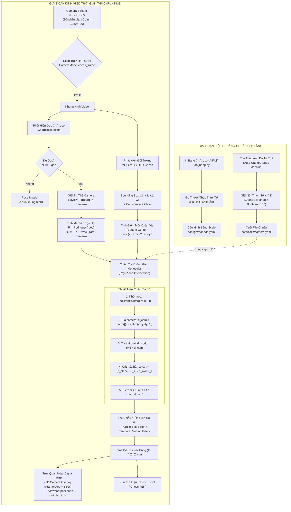
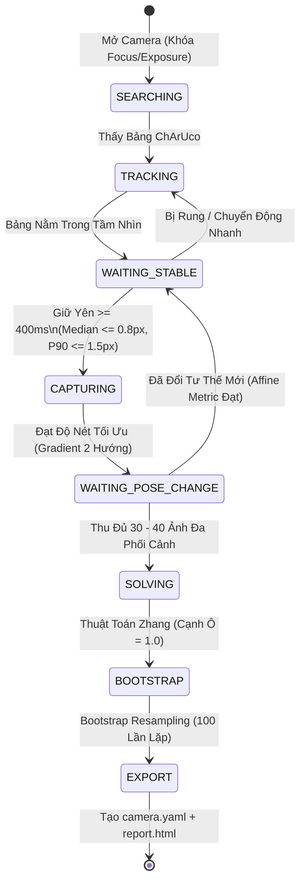

# PIPELINE HOẠT ĐỘNG HỆ THỐNG MONO EYE-IN-HAND 3D

> **Dự án:** Mono Eye-in-Hand 3D Localization  
> **Mục tiêu:** Từ một camera monocular duy nhất (gắn trên tay robot hoặc di động), sử dụng bảng ChArUco làm mốc tham chiếu không gian để ước lượng chính xác tọa độ thực 3D $(X, Y, Z)$ theo đơn vị **milimét (mm)** của các vật thể/quân cờ trên mặt bàn.

---

## 1. TỔNG QUAN KIẾN TRÚC PIPELINE

Hệ thống hoạt động dựa trên sự phối hợp chặt chẽ của hai phân hệ pipeline:
1. **Pipeline Hiệu chuẩn Ngoại tuyến (Offline Calibration Pipeline - `fov_tool`)**: Thực hiện 1 lần nhằm xác định chính xác các tham số nội của camera ($K, D$), đo góc mở ống kính (FOV) và lượng hóa độ bất định bằng phân tích Bootstrap.
2. **Pipeline Định vị Trực tuyến (Online Runtime Pipeline - `mono_eye`)**: Tiếp nhận từng khung hình camera $\to$ Giải tư thế camera (Camera Pose) $\to$ Phát hiện đối tượng (YOLO Detection) $\to$ Xác định điểm tiếp xúc mốc (Bottom-Center Reference Pixel) $\to$ Chiếu tia không gian (Ray-Plane Intersection) $\to$ Lọc nhiễu động học $\to$ Xuất tọa độ 3D và trực quan hóa Digital Twin.

### Sơ đồ luồng hoạt động tổng thể (End-to-End Pipeline)



---

## 2. CHI TIẾT TỪNG CÔNG ĐOẠN TRONG PIPELINE

### Giai đoạn 1: Chuẩn bị Vật lý & Thang đo Thực tế (`mono_eye/board_scale.py`)

Trong kỹ thuật thị giác máy tính monocular, camera chỉ nhìn thấy góc và pixel. Để chuyển đổi kết quả sang đơn vị vật lý milimét, **bảng ChArUco đóng vai trò là mốc chuẩn duy nhất xác lập hệ tọa độ thế giới (World Frame)**.

```
       ▲ Y_world (Chiều dọc bảng)
       │
       │   ┌───┬───┬───┬───┬───┐
       │   │ ■ │   │ ■ │   │ ■ │  ← Ô đen & ArUco Marker
       │   ├───┼───┼───┼───┼───┤
       │   │   │ ■ │   │ ■ │   │
       │   └───┴───┴───┴───┴───┘
       └────────────────────────► X_world (Chiều ngang bảng)
      (Gốc tọa độ [0,0,0], Z_world hướng thẳng đứng lên khỏi mặt bàn)
```

1. **Sinh file in ChArUco (`tao_bang.py`)**:
   - Bảng kết hợp giữa các ô đen trắng bàn cờ (cho độ chính xác xác định góc sub-pixel) và các mã ArUco dạng Dict `DICT_5X5_100` (giúp nhận diện ID từng góc độc lập ngay cả khi bảng bị che khuất một phần).
   - Xuất file cấu hình `bang_calib_A4.yaml` kèm kích thước danh nghĩa (ví dụ A4: `235.63 x 149.94 mm`, ô cờ `21.42 mm`).
2. **Đo kiểm thực tế (Bù co giãn nhiệt/máy in)**:
   - Máy in gia đình hoặc văn phòng luôn có sai số co giãn (0.5% - 2.0%).
   - Người vận hành dùng thước thép kỹ thuật đo chiều dài thực tế: mép ngoài ô đen trái $\to$ phải ($W_{meas}$) và trên $\to$ dưới ($H_{meas}$).
   - `mono_eye.board_scale` tự động tính hệ số tỉ lệ thực:
     $$s_x = \frac{W_{meas}}{W_{nominal}}, \quad s_y = \frac{H_{meas}}{H_{nominal}}$$
   - **Cổng kiểm soát độ dị hướng (Anisotropy Gate)**: Nếu $|s_x - s_y| / \text{mean}(s_x, s_y) > 1.5\%$, hệ thống cảnh báo bảng in bị méo bất đối xứng $\to$ yêu cầu in lại trên vật liệu cứng.

---

### Giai đoạn 2: Pipeline Hiệu chuẩn Máy ảnh Ngoại tuyến (`fov_tool`)

Để khử triệt để hiện tượng cong méo thấu kính (barrel/pincushion distortion) và tìm ma trận nội tham số $K$:
$$\mathbf{K} = \begin{bmatrix} f_x & 0 & c_x \\ 0 & f_y & c_y \\ 0 & 0 & 1 \end{bmatrix}, \quad \mathbf{D} = \begin{bmatrix} k_1 & k_2 & p_1 & p_2 & k_3 \end{bmatrix}$$



#### Quy trình chi tiết:
1. **Khóa phần cứng (`fov_tool/camera.py`)**:
   - Khóa Autofocus, White Balance, Auto-Exposure để tiêu cự quang học $f$ không bị trôi dạt trong suốt phiên làm việc.
2. **Auto-Capture State Machine (`fov_tool/acquisition.py`)**:
   - Không cho phép chụp liên tục khi camera đang di chuyển làm mờ ảnh (motion blur).
   - Chỉ lưu ảnh khi góc ChArUco đứng yên hoàn toàn trong $\ge 400\text{ ms}$ với độ lệch sub-pixel $\le 0.8\text{ px}$.
   - Kiểm tra tư thế bằng metric biến đổi Affine, bắt buộc người chụp phải nghiêng bảng từ $20^\circ - 45^\circ$ để tách biệt hoàn toàn giữa tiêu cự $f$ và hệ số méo bậc 1 $k_1$.
3. **Hiệu chuẩn Zhang với Cạnh ô = 1.0 (`fov_tool/calibration.py`)**:
   - Ở khâu tìm $K$ và $D$, cạnh ô được gán chuẩn hóa là $1.0$. Ma trận $K$ hoàn toàn **bất biến với thang đo thế giới** (scale-invariant).
4. **Đánh giá độ phân tán sai số thực tế bằng Bootstrap (100 lần)**:
   - Sai số chuẩn do hàm `cv2.calibrateCamera` trả về thường quá lạc quan (gấp 10 lần thực tế).
   - `fov_tool` thực hiện resampling ngẫu nhiên có hoàn lại 100 lần trên tập ảnh để đưa ra khoảng tin cậy thật sự cho $f_x, f_y$ và góc FOV (ví dụ: $\text{FOV}_{diag} = 80.41^\circ \pm 0.33^\circ$).
5. **Xuất kết quả (`fov_tool/export.py`)**:
   - Lưu trữ định dạng `cv::FileStorage` tại `data/calib/camera.yaml`.

---

### Giai đoạn 3: Ước lượng Tư thế Camera Thời gian thực (`mono_eye/pose.py`)

Trong quá trình vận hành, bảng ChArUco được đặt cố định trên mặt bàn làm việc ($Z_{world} = 0$). Khi camera di chuyển (trên tay robot hoặc cầm tay), vị trí và góc quay của camera đối với mặt bàn thay đổi liên tục.

```
       [ Camera quang học C ]
                 \
                  \  (rvec, tvec qua solvePnP)
                   ▼
    ════════════[ Bảng ChArUco ]════════════  (Mặt bàn phẳng Z = 0)
```

1. **Phát hiện góc ChArUco (`CharucoDetector`)**:
   - `cv2.aruco.CharucoDetector` tìm kiếm các marker ArUco và nội suy vị trí các góc giao nhau của bàn cờ với độ chính xác dưới điểm ảnh (sub-pixel corner refinement).
2. **Giải bài toán phối cảnh n điểm (Perspective-n-Point - PnP)**:
   - Hàm `cv2.solvePnP` khớp tập hợp điểm 3D của bảng (`objPoints` tính từ số đo mm thực tế) với các góc pixel tìm được (`imgPoints`).
   - Kết quả thu được:
     - Vector quay Rodrigues $\vec{r} = [r_x, r_y, r_z]^T$
     - Vector tịnh tiến $\vec{t} = [t_x, t_y, t_z]^T$ (biến đổi từ hệ tọa độ bảng sang hệ tọa độ camera).
3. **Chuyển đổi sang Hệ tọa độ Thế giới (World Frame)**:
   - Ma trận xoay $3 \times 3$: $\mathbf{R} = \text{Rodrigues}(\vec{r})$
   - **Tâm máy ảnh trong hệ thế giới (Camera Optical Center)**:
     $$\mathbf{C}_{world} = -\mathbf{R}^T \cdot \vec{t} = \begin{bmatrix} C_x \\ C_y \\ C_z \end{bmatrix}$$
   - Góc Euler quan sát: Tính trực tiếp Roll, Pitch, Yaw từ ma trận $\mathbf{R}$.
4. **Cổng kiểm soát chất lượng Pose (Quality Gates)**:
   - **Số góc tối thiểu**: $N_{corners} \ge 6$ (tránh hiện tượng đa nghiệm PnP).
   - **Sai số tái chiếu (Reprojection Error)**: $e_{reproj} = \sqrt{\frac{1}{N}\sum \|p_i - \hat{p}_i\|^2} \le 1.5\text{ px}$ (hoặc tối đa $6.0\text{ px}$ trong điều kiện ánh sáng phức tạp).
   - Nếu không thỏa mãn, `CameraPose.valid = False`, khung hình bị gắn cờ từ chối tính 3D.

---

### Giai đoạn 4: Nhận diện Đối tượng & Xác định Điểm Mốc Tiếp Xúc (`mono_eye/detect.py` & `mono_eye/chess_detectors.py`)

```
   Bounding Box 2D: [x1, y1, x2, y2]
   ┌───────────────────────┐
   │       /\_/\           │
   │      ( o.o )  (Vật)   │
   │       > ^ <           │
   │      /     \          │
   └──────────●────────────┘
              ▲
              │
    Điểm Mốc Tiếp Xúc Đáy (Bottom-Center Reference Pixel)
    u_ref = (x1 + x2) / 2
    v_ref = y2
```

1. **Inference Mô hình YOLO**:
   - Chạy mô hình nhẹ (YOLOv8n / YOLOv11) trên CPU hoặc GPU/CUDA.
   - Trích xuất: Bounding Box $[x_1, y_1, x_2, y_2]$, Độ tin cậy (Confidence $\ge 0.5$), Lớp đối tượng (Class ID / FEN Character).
2. **Nguyên lý Chọn Điểm Mốc Tiếp Xúc Đáy (Contact Reference Point)**:
   - Trong thị giác monocular, nếu lấy tâm Bounding Box $((x_1+x_2)/2, (y_1+y_2)/2)$, điểm đó nằm lơ lửng trong không khí trên thân vật thể, dẫn đến việc chiếu tia xuống mặt bàn $Z=0$ sẽ cho tọa độ bị dịch ra phía sau vật.
   - Điểm tiếp xúc vật lý giữa vật thể và mặt bàn chính là **chính giữa cạnh đáy của bounding box**:
     $$u_{ref} = \frac{x_1 + x_2}{2}, \quad v_{ref} = y_2$$
   - Điểm $(u_{ref}, v_{ref})$ đại diện chính xác cho chân đế của vật nằm áp sát trên mặt phẳng $Z_{world} = 0$.

---

### Giai đoạn 5: Chiếu Tia Hình Học 3D (Ray-Plane Intersection - `mono_eye/projection.py`)

Đây là trung tâm toán học của toàn bộ hệ thống định vị monocular: **Biến đổi từ một pixel 2D trên ảnh thành tọa độ thực $(X, Y, Z)$ tính bằng mm trong không gian 3D**.

```
    Tâm Camera C_world
         ●
          \
           \  Tia nhìn d_world
            \
             \
              ▼
   ════════════●═════════════════════ Mặt bàn Z = z_plane (0 mm)
               P_world = (X, Y, 0)
```

#### Các bước tính toán hình học giải tích:

1. **Bước 1: Khử méo pixel (Pixel Undistortion)**
   Sử dụng ma trận $K$ và vector hệ số méo $D$:
   $$(u_{undist}, v_{undist}) = \text{cv2.undistortPoints}\Big([u_{ref}, v_{ref}], \mathbf{K}, \mathbf{D}, \mathbf{P}=\mathbf{K}\Big)$$
   Thu được tọa độ pixel lý tưởng tương ứng với mô hình Pinhole hoàn hảo không méo.

2. **Bước 2: Tạo vector hướng tia trong hệ tọa độ Camera**
   Từ phương trình máy ảnh pinhole:
   $$\vec{v}_{cam} = \begin{bmatrix} \dfrac{u_{undist} - c_x}{f_x} \\[6pt] \dfrac{v_{undist} - c_y}{f_y} \\[6pt] 1.0 \end{bmatrix}$$
   Chuẩn hóa thành vector đơn vị:
   $$\vec{d}_{cam} = \frac{\vec{v}_{cam}}{\|\vec{v}_{cam}\|}$$

3. **Bước 3: Chuyển đổi vector hướng tia sang hệ tọa độ Thế giới (World Frame)**
   Vì ma trận xoay $\mathbf{R}$ biến đổi từ World $\to$ Camera, nên biến đổi ngược từ Camera $\to$ World sử dụng ma trận chuyển vị $\mathbf{R}^T$:
   $$\vec{d}_{world} = \mathbf{R}^T \cdot \vec{d}_{cam} = \begin{bmatrix} d_{world, x} \\ d_{world, y} \\ d_{world, z} \end{bmatrix}$$

4. **Bước 4: Cắt tia với mặt phẳng bàn nằm ngang ($Z = z_{plane}$)**
   - Phương trình đường thẳng của tia xuất phát từ tâm camera $\mathbf{C}$:
     $$\mathbf{P}(t) = \mathbf{C}_{world} + t \cdot \vec{d}_{world}, \quad (t > 0)$$
   - Ràng buộc mặt phẳng bàn: $P_z(t) = z_{plane}$ (thường mặt bàn trùng mặt bảng ChArUco nên $z_{plane} = 0.0\text{ mm}$):
     $$C_z + t \cdot d_{world, z} = z_{plane} \implies t = \frac{z_{plane} - C_z}{d_{world, z}}$$
   - **Tọa độ thực 3D cuối cùng**:
     $$\begin{cases}
     X = C_x + t \cdot d_{world, x} \\
     Y = C_y + t \cdot d_{world, y} \\
     Z = z_{plane}
     \end{cases}$$

---

### Giai đoạn 6: Lọc Nhiễu Động Học & Ổn Định Dữ Liệu (`mono_eye/filter.py`)

Trong thực tế, vi rung tay cầm, nhiễu cảm biến ảnh (sensor noise), và sự dao động 1-2 pixel của Bounding Box từ YOLO có thể gây rung lắc tọa độ 3D. Giai đoạn này đảm bảo độ chụm và ổn định:

1. **Bộ lọc tia song song / Góc nhìn quá nông (`filter_parallel_ray`)**:
   - Nếu hướng tia gần như nằm ngang $(|d_{world, z}| < 0.05)$, góc nghiêng tia so với mặt bàn $< 3^\circ$.
   - Khi đó mẫu số $d_{world, z} \approx 0$, một sai lệch $0.5\text{ px}$ trên ảnh sẽ bị khuếch đại thành sai số hàng trăm milimét trên bàn. Hệ thống tự động loại bỏ các điểm có góc chiếu quá nông này.
2. **Bộ làm mượt theo thời gian (`TemporalSmoother`)**:
   - Duy trì một cửa sổ trượt (sliding window) kích thước $N = 5$ khung hình gần nhất cho từng `track_id` hoặc lớp đối tượng.
   - Áp dụng bộ lọc Trung vị (Median Filter) độc lập trên trục $X$ và $Y$:
     $$X_{smooth} = \text{median}\big(X_{t-4}, X_{t-3}, \dots, X_t\big)$$
   - Lọc bỏ hoàn toàn các gai nhiễu đột biến (outliers) mà không gây trễ pha lớn như trung bình cộng.
3. **Bộ lọc Kalman 3D (`KalmanFilter3D`)**:
   - Mô hình không gian trạng thái 6 chiều: $[x, y, z, \dot{x}, \dot{y}, \dot{z}]^T$.
   - Tối ưu cho kịch bản theo dõi vật thể đang được tay robot hoặc người gắp di chuyển liên tục.
4. **Giao tia Đa góc nhìn (`triangulate_two_views`)**:
   - Dùng khi vật thể lơ lửng trong không trung ($Z \neq 0$ chưa biết).
   - Khi camera di chuyển giữa 2 vị trí khác nhau $\mathbf{C}_1$ và $\mathbf{C}_2$, hệ thống tìm đoạn vuông góc chung ngắn nhất giữa hai tia chéo nhau trong không gian để xác định tọa độ 3D tự do.

---

### Giai đoạn 7: Trực Quan Hóa & Giao Tiếp Hệ Thống (`mono_eye/viz.py`)

Hệ thống cung cấp hai giao diện trực quan hóa thời gian thực phục vụ giám sát và gỡ lỗi:

1. **2D Augmented Overlay (Trên luồng Camera)**:
   - Dùng `cv2.drawFrameAxes` vẽ 3 trục tọa độ thế giới ngay tại gốc bảng ChArUco (Trục X: Đỏ, Trục Y: Xanh lá, Trục Z: Xanh dương vươn thẳng lên).
   - Vẽ khung chữ nhật Bounding Box bao quanh vật, chấm tròn đỏ tại điểm mốc tiếp xúc đáy.
   - Hiển thị nhãn OSD: Tên lớp, độ tin cậy, tọa độ thực: `white_knight: X=186.2, Y=37.3 mm`, số góc ChArUco nhìn thấy, và sai số tái chiếu.
2. **3D Realtime Digital Twin Viewport (`scripts/realtime_chess_viz.py` / `rerun-sdk`)**:
   - Render khung nhìn 3D trực giao hoặc phối cảnh song song:
     - Mặt phẳng bàn làm việc $Z=0$ dạng lưới tọa độ (Grid plane).
     - Tấm ChArUco chuẩn với các hoa văn ô đen trắng.
     - Vị trí hình chóp cụt camera ảo (Frustum) đang bay lượn tương ứng với vị trí thực tế của camera.
     - Dải đường cong quỹ đạo di chuyển (Trajectory) của camera.
     - Các cột mốc / mô hình 3D quân cờ được cắm đúng tọa độ $(X, Y, 0)$ trên bàn.

---

## 3. HAI BIẾN THỂ PIPELINE THỰC TẾ TRONG MÃ NGUỒN

Dự án cung cấp sẵn hai lớp Pipeline chuyên biệt:

| Đặc tính | `MonoEyePipeline` (`mono_eye/pipeline.py`) | `ChessMonoEyePipeline` (`mono_eye/chess_pipeline.py`) |
|---|---|---|
| **Mục đích** | Định vị tổng quát vật thể công nghiệp (hộp, lon, cốc, đồ cơ khí) | Định vị bàn cờ vua & 32 quân cờ, hỗ trợ robot chơi cờ |
| **Mô hình Detector** | `ObjectDetector` (YOLOv8 mặc định COCO hoặc custom) | `ChessPieceDetector` (Model chuyên biệt 12 lớp cờ vua: P, N, B, R, Q, K) |
| **Điểm mốc quy chiếu** | Cấu hình linh hoạt: `bottom_center`, `center`, `custom_offset` | `bottom_center` (chân đế tiếp xúc mặt bàn cờ) |
| **Hậu xử lý** | Lọc động học Temporal Smoothing / Kalman | Ánh xạ tọa độ $(X,Y)$ sang ô cờ vua (`a1` $\to$ `h8`) + Chuỗi FEN |
| **Script thực thi** | `scripts/realtime_viz.py` | `scripts/realtime_chess_viz.py` |

---

## 4. BẢNG CẤU HÌNH THAM SỐ & CỔNG CHẤT LƯỢNG (QUALITY GATES)

Mọi ngưỡng kiểm soát chất lượng được định nghĩa tập trung tại `configs/mono3d.yaml` và các class tương ứng:

| Tham số / Cổng kiểm soát | Giá trị chuẩn | Ý nghĩa & Hành vi nếu vi phạm |
|---|---|---|
| `board.max_anisotropy` | `0.015` (1.5%) | Độ lệch co giãn ngang/dọc của bảng in. Nếu $>1.5\%$ $\to$ cảnh báo in lại bảng. |
| `pose.min_charuco_corners` | `6` góc | Số góc ChArUco tối thiểu để giải PnP. Nếu $<6$ $\to$ `pose.valid = False`, bỏ qua frame. |
| `pose.max_reproj_error_px` | `1.5 - 6.0` px | Ngưỡng sai số tái chiếu RMS. Vượt ngưỡng $\to$ Pose bị rung/lệch, từ chối tính 3D. |
| `filter.min_ray_z` | `0.05` (~$2.9^\circ$) | Loại bỏ các tia chiếu song song hoặc quá sát mặt bàn để tránh bùng nổ sai số. |
| `filter.smooth_window` | `5` frames | Kích thước cửa sổ lọc trung vị khử rung tọa độ. |
| `detector.conf_threshold` | `0.50` (50%) | Độ tin cậy tối thiểu của bounding box YOLO để tiến hành chiếu 3D. |

---

## 5. HƯỚNG DẪN THỰC THI NHANH TỪNG BƯỚC PIPELINE

### Bước 1: Kiểm tra môi trường phần cứng
```powershell
uv sync
uv run python scripts/check_env.py --camera 0
```

### Bước 2: Hiệu chuẩn camera tạo `camera.yaml` (Chỉ làm 1 lần)
```powershell
# Chụp ảnh tự động (nghiêng bảng 20-45 độ, di chuyển 4 góc khung hình)
.\run_fov.ps1 capture --camera 0 --name calib_session --width 1280 --height 720

# Phân tích nội tham số K, D với 100 lần lặp Bootstrap
.\run_fov.ps1 analyze sessions\calib_session --bootstrap 100

# Xuất kết quả
.\run_fov.ps1 export sessions\calib_session --name "my_camera"

# Copy vào vị trí chuẩn của pipeline
copy sessions\calib_session\runs\<run_id>\export\camera.yaml data\calib\camera.yaml
```

### Bước 3: Chạy Pipeline Định vị 3D Realtime
```powershell
# Cách A: Chạy Dashboard trực quan hóa cờ vua (Màn hình kép Camera 2D + 3D Viewport)
uv run python scripts/realtime_chess_viz.py --camera 0

# Cách B: Chạy Pipeline tổng quát với vật thể thông thường
uv run python scripts/realtime_viz.py --camera 0
```

### Bước 4: Chạy kiểm thử tự động toàn bộ Pipeline
```powershell
uv run pytest tests/ -v
```

---

## 6. SƠ ĐỒ ÁNH XẠ MÃ NGUỒN (SOURCE CODE MAPPING)

| Giai đoạn trong Pipeline | Tệp mã nguồn phụ trách | Vai trò chính |
|---|---|---|
| **Sinh & Scale Bảng** | `tao_bang.py`, `mono_eye/board_scale.py` | Tạo PDF ChArUco, tính cạnh ô thực theo số đo thước thép. |
| **Hiệu chuẩn Camera** | `fov_tool/camera.py`, `calibration.py`, `export.py` | Auto-capture, Zhang calibration, Bootstrap error, xuất `camera.yaml`. |
| **Nạp cấu hình** | `mono_eye/camera_io.py`, `mono_eye/config.py` | Kiểm tra kích thước khung hình, nạp $K$ và $D$. |
| **Ước lượng Tư thế** | `mono_eye/pose.py` | `PoseEstimator`: CharucoDetector, `solvePnP`, Rodrigues, tính tâm $C$. |
| **Phát hiện Đối tượng** | `mono_eye/detect.py`, `mono_eye/chess_detectors.py` | YOLO inference, tính reference pixel bottom-center. |
| **Chiếu tia Monocular 3D** | `mono_eye/projection.py` | `ProjectionProcessor`: Undistort, Ray generation, Ray-Plane intersection. |
| **Lọc nhiễu & Ổn định** | `mono_eye/filter.py` | `TemporalSmoother`, `KalmanFilter3D`, `filter_parallel_ray`. |
| **Điều phối Pipeline** | `mono_eye/pipeline.py`, `chess_pipeline.py` | Kết nối toàn bộ luồng, kiểm soát vòng lặp xử lý video/camera. |
| **Trực quan hóa & Báo cáo** | `mono_eye/viz.py`, `scripts/realtime_chess_viz.py` | 2D annotated stream, 3D Digital Twin Viewport, ghi nhận log sai số. |
| **Bàn cờ 8x8 & Đa Quân Cờ** | `mono_eye/chess_board_grid.py`, `configs/banco_8x8.yaml` | Ánh xạ ô cờ $a1-h8$, phân xử xung đột đa quân cờ, bù che khuất, sinh FEN. |

---

## 7. MỞ RỘNG BẢNG KÉP & BÀN CỜ VUA 8X8 THỰC TẾ (DUAL BOARD & CHESSBOARD 8X8)

Hệ thống hỗ trợ song song hai loại mốc không gian:
1. **Bảng ChArUco Chuẩn (A4/A3)**: Sử dụng ma trận góc sub-pixel của bàn cờ kết hợp ArUco marker.
2. **Bàn cờ vua 8x8 thực tế (`configs/banco_8x8.yaml`)**:
   - 64 ô cờ kích thước chuẩn $40.0 \times 40.0\text{ mm}$ (toàn vùng $320 \times 320\text{ mm}$).
   - 32 marker ArUco (`cv2.aruco.DICT_4X4_50`, kích thước $24.0\text{ mm}$) dán trên 32 ô sáng màu.
   - Giải tư thế camera bằng `cv2.solvePnPRansac` với mô hình 128 điểm góc 3D, duy trì Pose ổn định ngay cả khi 15-20 marker bị quân cờ che khuất.
   - Cơ chế **Pose Hold** lưu giữ tư thế đến 5 khung hình khi tay người hoặc vật cản che khuất tức thời.

### Chế độ nhận diện bảng (`--board-type`):
- `--board-type auto` *(Mặc định)*: Tự động phân tích khung hình, nhận diện xem camera đang nhìn vào Bàn cờ 8x8 hay Bảng ChArUco để chọn thuật toán PnP tương ứng.
- `--board-type chessboard`: Ép buộc sử dụng mô hình Bàn cờ 8x8.
- `--board-type charuco`: Ép buộc sử dụng mô hình Bảng ChArUco A4/A3.

### Các lệnh chạy mẫu:
```powershell
# Chạy trực quan hóa thời gian thực tự động nhận diện bảng
python scripts/realtime_chess_viz.py --source 1 --board-type auto

# Chạy phân tích ảnh tĩnh bàn cờ 8x8
python scripts/run_chess_pipeline.py --source picchess/banco.jpg --board-type auto --no-show

# Chạy phân tích video ChArUco hiện có
python scripts/run_chess_pipeline.py --source videochess/4quanco.mp4 --board-type auto --no-show
```

