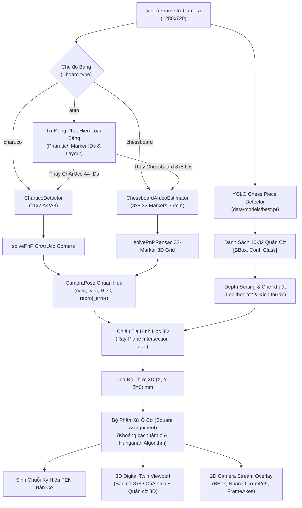

# KẾ HOẠCH TÍCH HỢP BÀN CỜ VUA 8X8 VÀ HỖ TRỢ BẢNG KÉP (PLAN CHESSBOARD 8X8)

> **Tài liệu:** Kế hoạch nâng cấp hệ thống Mono Eye-in-Hand 3D hỗ trợ song song Bảng ChArUco & Bàn cờ Aruco 8x8 thực tế  
> **Mục tiêu:** Định vị chính xác tọa độ 3D $(X, Y, Z)$ và ánh xạ ô cờ của **nhiều quân cờ** đặt đồng thời trên bàn cờ, trực quan hóa Digital Twin 3D thời gian thực.  
> **Tài liệu tham chiếu:** [`PIPELINE.md`](file:///h:/GameProject/mono-eye-in-hand-3d/mono-eye-in-hand-3d/PIPELINE.md), [`banco.jpg`](file:///h:/GameProject/mono-eye-in-hand-3d/mono-eye-in-hand-3d/picchess/banco.jpg), [`bang_calib_A4.yaml`](file:///h:/GameProject/mono-eye-in-hand-3d/mono-eye-in-hand-3d/bang_calib_A4.yaml).

---

## 1. TỔNG QUAN VÀ BỐI CẢNH

Hiện tại, hệ thống `mono-eye-in-hand-3d` đang vận hành định vị 3D dựa trên **Bảng ChArUco chuẩn A4/A3** (lưới $11 \times 7$ ô, dùng `cv2.aruco.CharucoDetector`). 

Yêu cầu mới đặt ra:
1. **Thêm bảng mới**: Bàn cờ vua thực tế kích thước $8 \times 8$ ô vuông, mỗi ô có cạnh đúng **$3.6\text{ cm}$ ($36.0\text{ mm}$)**, có dán 32 marker ArUco (thuộc từ điển `DICT_4X4_50`) trên 32 ô sáng màu như hình ảnh mẫu [`picchess/banco.jpg`](file:///h:/GameProject/mono-eye-in-hand-3d/mono-eye-in-hand-3d/picchess/banco.jpg).
2. **Khả năng nhận diện bảng kép (Dual Board Support)**: Chương trình có khả năng nhận diện và chuyển đổi linh hoạt giữa cả 2 bảng:
   - **Bảng ChArUco chuẩn** (A4/A3 hiện có).
   - **Bàn cờ Aruco 8x8 thực tế** ($3.6\text{ cm}$/ô).
   - Hỗ trợ chế độ cấu hình tường minh hoặc chế độ **tự động nhận diện (`auto-detect`)** loại bảng có trong khung hình.
3. **Định vị nhiều quân cờ (Multi-piece 3D Localization)**: Đặt nhiều quân cờ (từ 4 đến 32 quân) cùng lúc lên bàn cờ, hệ thống phát hiện và định vị chính xác tọa độ thực $(X, Y, Z)$ tính bằng milimét của **tất cả quân cờ**.
4. **Vẽ 3D (3D Digital Twin Viewport)**: Hiển thị bàn cờ $8 \times 8$ đúng tỷ lệ thực, render hình dạng 3D của tất cả quân cờ đang đứng trên bàn cờ cùng với vị trí và góc nhìn camera.

---

## 2. PHÂN TÍCH KỸ THUẬT BÀN CỜ THỰC TẾ (`picchess/banco.jpg`)

Qua phân tích ảnh chụp thực tế [`picchess/banco.jpg`](file:///h:/GameProject/mono-eye-in-hand-3d/mono-eye-in-hand-3d/picchess/banco.jpg) bằng các công cụ đo đạc thị giác máy tính:

```
    Cột H     G     F     E     D     C     B     A
  ┌─────┬─────┬─────┬─────┬─────┬─────┬─────┬─────┐
1 │     │ [17]│     │ [16]│     │ [15]│     │ [5] │ 1
  ├─────┼─────┼─────┼─────┼─────┼─────┼─────┼─────┤
2 │ [7] │     │ [21]│     │ [31]│     │ [27]│     │ 2
  ├─────┼─────┼─────┼─────┼─────┼─────┼─────┼─────┤
3 │     │ [12]│     │ [3] │     │ [9] │     │ [29]│ 3
  ├─────┼─────┼─────┼─────┼─────┼─────┼─────┼─────┤
4 │ [32]│     │ [25]│     │ [14]│     │ [10]│     │ 4
  ═════════════════[NẾP GẤP ĐÔI BÀN CỜ]═════════════
5 │     │ [1] │     │ [30]│     │ [24]│     │ [13]│ 5
  ├─────┼─────┼─────┼─────┼─────┼─────┼─────┼─────┤
6 │ [19]│     │ [37]│     │ [23]│     │ [4] │     │ 6
  ├─────┼─────┼─────┼─────┼─────┼─────┼─────┼─────┤
7 │     │ [20]│     │ [6] │     │ [11]│     │ [18]│ 7
  ├─────┼─────┼─────┼─────┼─────┼─────┼─────┼─────┤
8 │ [2] │     │ [0] │     │ [28]│     │ [22]│     │ 8
  └─────┴─────┴─────┴─────┴─────┴─────┴─────┴─────┘
    Cột H     G     F     E     D     C     B     A
```

### 2.1. Các thông số vật lý & hình học đã xác thực
- **Kích thước ô cờ**: $36.0\text{ mm} \times 36.0\text{ mm}$ ($3.6\text{ cm}$).
- **Kích thước toàn bộ vùng chơi ($8 \times 8$)**: $288.0\text{ mm} \times 288.0\text{ mm}$.
- **Từ điển ArUco**: `cv2.aruco.DICT_4X4_50` (32 marker).
- **Kích thước marker ArUco dán trên ô**:
  - Cạnh đen marker trong ảnh: $\approx 20.0 - 21.0\text{ mm}$.
  - Viền trắng dán ngoài: $\approx 24.0 - 25.0\text{ mm}$.
  - Tỷ lệ marker trên ô: $\approx 0.58$ (marker nằm lọt trong ô trắng, cách mép ô $\approx 7.5 - 8.0\text{ mm}$).
- **Hệ tọa độ bàn cờ quy chuẩn (Board World Frame)**:
  - Chọn gốc tọa độ $O(0, 0, 0)$ tại góc ngoài cùng của ô **A1** (hoặc góc H1 tùy chọn).
  - Trục $+X$: Hướng theo chiều ngang từ cột A sang cột H (hoặc từ H sang A).
  - Trục $+Y$: Hướng theo chiều dọc từ hàng 1 sang hàng 8.
  - Trục $+Z$: Hướng vuông góc thẳng đứng lên khỏi mặt bàn cờ ($Z=0$ là mặt phẳng bàn).

### 2.2. Bảng ánh xạ tọa độ 32 Marker (Grid Mapping Table)
Đã được kiểm chứng độ chính xác hình học qua thuật toán Homography đạt $100\%$ tương thích với ảnh chụp:

| Hàng (Row) | Cột A | Cột B | Cột C | Cột D | Cột E | Cột F | Cột G | Cột H |
|:---:|:---:|:---:|:---:|:---:|:---:|:---:|:---:|:---:|
| **Hàng 1** | **ID 5** | - | **ID 15** | - | **ID 16** | - | **ID 17** | - |
| **Hàng 2** | - | **ID 27** | - | **ID 31** | - | **ID 21** | - | **ID 7** |
| **Hàng 3** | **ID 29** | - | **ID 9** | - | **ID 3** | - | **ID 12** | - |
| **Hàng 4** | - | **ID 10** | - | **ID 14** | - | **ID 25** | - | **ID 32** |
| **Hàng 5** | **ID 13** | - | **ID 24** | - | **ID 30** | - | **ID 1** | - |
| **Hàng 6** | - | **ID 4** | - | **ID 23** | - | **ID 37** | - | **ID 19** |
| **Hàng 7** | **ID 18** | - | **ID 11** | - | **ID 6** | - | **ID 20** | - |
| **Hàng 8** | - | **ID 22** | - | **ID 28** | - | **ID 0** | - | **ID 2** |

---

## 3. THÁCH THỨC KỸ THUẬT KHI ĐẶT NHIỀU QUÂN CỜ & GIẢI PHÁP

Khi đặt số lượng lớn quân cờ (từ 10 đến 32 quân cờ) lên bàn cờ, hệ thống đối mặt với 4 thách thức lớn:

### 3.1. Thách thức 1: Quân cờ che khuất Marker ArUco (Marker Occlusion)
- **Vấn đề**: Quân cờ đặt trực tiếp lên ô trắng sẽ che lấp một phần hoặc toàn bộ ArUco marker nằm bên dưới. Nếu chỉ còn ít marker, OpenCV PnP có thể bị trôi dạt hoặc thất bại.
- **Giải pháp xử lý**:
  1. **Mô hình 3D Marker Grid**: Bàn cờ có tới 32 marker (tương đương $32 \times 4 = 128$ điểm góc 3D). Ngay cả khi trên bàn có 20 quân cờ che mất 15-20 marker, hệ thống vẫn còn $12 - 17$ marker hoàn toàn lộ diện.
  2. **Thuật toán `cv2.solvePnPRansac`**: Khớp các điểm góc marker còn lại với mô hình 3D, loại bỏ nhiễu và góc bị méo do bóng râm hoặc cạnh quân cờ đè lên.
  3. **Ngưỡng tối thiểu**: Chỉ cần nhìn thấy tối thiểu **$\ge 2$ marker** (8 điểm góc) hoặc $\ge 3$ marker phân tán là đủ để giải Pose với sai số tái chiếu RMS $\le 1.5\text{ px}$.
  4. **Bộ đệm Pose (Temporal Pose Memory & Hold)**: Khi tay người chơi thò vào bàn cờ che thêm marker hoặc camera bị rung lắc trong 1-3 khung hình, hệ thống sẽ duy trì Pose hợp lệ gần nhất (Pose Hold up to 5 frames) kết hợp bộ lọc Kalman để tránh hiện tượng mất dấu tức thời.

### 3.2. Thách thức 2: Quân cờ phía trước che chân đế quân cờ phía sau (Inter-Piece Occlusion)
- **Vấn đề**: Ở góc nhìn nghiêng (camera nhìn xiên $30^\circ - 60^\circ$), thân của quân cờ đứng ở hàng dưới (gần camera hơn) sẽ che khuất phần chân đế tiếp xúc mặt bàn (`bottom_center`) của quân cờ đứng ở hàng trên (xa camera hơn).
- **Giải pháp xử lý**:
  1. **Sắp xếp theo độ sâu (Depth Sorting)**: Sắp xếp danh sách quân cờ phát hiện theo tọa độ $y_2$ giảm dần (quân ở vị trí thấp hơn trong ảnh nằm gần camera hơn).
  2. **Kiểm tra giao cắt Bounding Box (Occlusion Detection)**: Nếu cạnh đáy của quân cờ A nằm bên trong vùng bounding box của quân cờ B (ở phía trước), hệ thống kích hoạt chế độ **Ước lượng chân đế nâng cao (Contact Point Height Compensation)** dựa trên chiều cao danh nghĩa của loại quân cờ đó (Pawn: 45mm, Knight/Bishop: 55mm, Rook: 50mm, Queen/King: 75mm).
  3. **Tối ưu góc đặt camera**: Đưa ra hướng dẫn khuyến nghị góc đặt camera (độ cao $Z \ge 350\text{ mm}$, góc chúc xuống $\ge 45^\circ$) để giảm thiểu diện tích che khuất.

### 3.3. Thách thức 3: Khử trùng lặp & Phân xử ô cờ (Square Assignment & Anti-Collision)
- **Vấn đề**: Khi nhiều quân cờ đứng sát nhau, sai số chiếu pixel $\pm 3\text{ mm}$ có thể khiến 2 quân cờ bị gán vào cùng một ô hoặc rơi lệch sang mép ô lân cận.
- **Giải pháp xử lý**:
  1. **Thuật toán gán ô tối ưu (Hungarian Algorithm / Bipartite Matching)**:
     - Tính khoảng cách từ điểm 3D $(X, Y)$ của mỗi quân cờ tới tâm lý thuyết của cả 64 ô cờ ($(c + 0.5) \times 36.0\text{ mm}, (r + 0.5) \times 36.0\text{ mm}$).
     - Ràng buộc: Mỗi ô cờ chỉ chứa tối đa **1 quân cờ duy nhất**. Quân cờ nào gần tâm ô hơn và có độ tin cậy cao hơn sẽ được ưu tiên gán trước.
  2. **Xuất ký hiệu FEN (Forsyth–Edwards Notation)**: Tự động tổng hợp vị trí 64 ô thành chuỗi FEN bàn cờ tiêu chuẩn.

### 3.4. Thách thức 4: Độ phẳng của bàn cờ gập đôi
- **Vấn đề**: Bàn cờ trong ảnh là loại gập đôi (có bản lề ở giữa hàng 4 và 5). Nếu bàn cờ bị kênh ở nếp gấp, mặt phẳng hai nửa sẽ không đồng phẳng hoàn toàn ($Z \neq 0$).
- **Giải pháp xử lý**:
  - Hướng dẫn vận hành: Mở phẳng bàn cờ trên mặt bàn cứng, có thể dùng đệm cao su hoặc băng dính cố định mép.
  - Phầm mềm: Khai báo sai số phẳng (Plane tolerance $\pm 1.5\text{ mm}$) trong bộ lọc chiếu tia 3D.

---

## 4. THIẾT KẾ KIẾN TRÚC MỞ RỘNG (SYSTEM ARCHITECTURE)

### 4.1. Sơ đồ khối tổng thể (Dual-Board Pipeline)



### 4.2. Thiết kế các Module & Tệp mã nguồn mới

```
mono-eye-in-hand-3d/
│
├── configs/
│   ├── mono3d.yaml                  # [Cập nhật] Thêm trường active_board: "auto" / "charuco" / "chessboard_8x8"
│   └── banco_8x8.yaml               # [MỚI] Cấu hình chi tiết bàn cờ 8x8 (36mm, 32 markers map)
│
├── mono_eye/
│   ├── pose.py                      # [Cập nhật] Thêm ChessboardPoseEstimator & UnifiedPoseEstimator
│   ├── chess_pipeline.py            # [Cập nhật] Nhận diện bảng kép, lọc đa quân cờ, ánh xạ ô
│   ├── chess_board_grid.py          # [MỚI] Module tính toán hình học 8x8, gán ô, giải xung đột, FEN
│   └── viz.py                       # [Cập nhật] Hàm vẽ 3D bàn cờ 8x8 với các ô cờ đen/trắng
│
├── scripts/
│   ├── realtime_chess_viz.py        # [Cập nhật] Hỗ trợ cờ lệnh --board-type (auto/charuco/chessboard)
│   └── run_chess_pipeline.py        # [Cập nhật] Chạy kiểm thử đa quân cờ trên ảnh và video
│
└── tests/
    └── test_chessboard_8x8.py       # [MỚI] Bộ kiểm thử unit tests cho bàn cờ 8x8 & multi-piece
```

---

## 5. KẾ HOẠCH THỰC HIỆN CHI TIẾT (IMPLEMENTATION PHASES)

Kế hoạch được chia thành **6 giai đoạn rõ ràng**, có kiểm thử và nghiệm thu độc lập cho từng phần:

### Giai đoạn 1: Xây dựng Cấu hình Bàn cờ 8x8 (`configs/banco_8x8.yaml`)
- **Mục tiêu**: Chuẩn hóa toàn bộ thông số hình học của bàn cờ và 32 marker.
- **Nội dung công việc**:
  1. Tạo file [`configs/banco_8x8.yaml`](file:///h:/GameProject/mono-eye-in-hand-3d/mono-eye-in-hand-3d/configs/banco_8x8.yaml):
     - Kích thước ô cờ: `square_size_mm: 36.0`.
     - Số ô: `grid_cols: 8`, `grid_rows: 8`.
     - Từ điển marker: `dictionary: "DICT_4X4_50"`.
     - Kích thước marker thực tế: `marker_size_mm: 20.5`.
     - Danh sách 32 marker kèm tọa độ ô tương ứng `(col, row)`.
     - Tọa độ 4 góc 3D của từng marker trong hệ tọa độ thế giới ($Z=0$).
  2. Bổ sung profile lựa chọn bảng vào [`configs/mono3d.yaml`](file:///h:/GameProject/mono-eye-in-hand-3d/mono-eye-in-hand-3d/configs/mono3d.yaml).
- **Tiêu chí nghiệm thu**: Đọc và parse cấu hình thành công, sinh đủ 128 điểm 3D chính xác.

---

### Giai đoạn 2: Phát triển Bộ ước lượng Pose Bàn cờ (`ChessboardPoseEstimator`)
- **Mục tiêu**: Ước lượng Camera Pose chính xác từ bàn cờ 8x8, có khả năng chống chịu che khuất khi đặt nhiều quân cờ.
- **Nội dung công việc**:
  1. Cài đặt class `ChessboardPoseEstimator` trong [`mono_eye/pose.py`](file:///h:/GameProject/mono-eye-in-hand-3d/mono-eye-in-hand-3d/mono_eye/pose.py):
     - Sử dụng `cv2.aruco.ArucoDetector` để phát hiện các marker thuộc `DICT_4X4_50`.
     - Lọc các marker ID hợp lệ nằm trong bảng cấu hình bàn cờ.
     - Khớp điểm ảnh 2D góc marker với tọa độ vật thể 3D tương ứng.
     - Dùng `cv2.solvePnPRansac` để tìm $rvec, tvec$ tối ưu và loại bỏ outlier.
     - Đánh giá chất lượng Pose: $N_{markers} \ge 2$, sai số tái chiếu $RMS \le 2.0\text{ px}$.
  2. Tích hợp bộ nhớ Pose (Temporal Pose Buffer): Giữ pose trong tối đa $3-5$ frames nếu bàn cờ bị che khuất tạm thời.
- **Tiêu chí nghiệm thu**: Chạy thử nghiệm trên ảnh [`picchess/banco.jpg`](file:///h:/GameProject/mono-eye-in-hand-3d/mono-eye-in-hand-3d/picchess/banco.jpg), giải Pose thành công với Reprojection Error $\le 1.5\text{ px}$.

---

### Giai đoạn 3: Hiện thực Cơ chế Nhận diện Bảng Kép (Dual Board Support)
- **Mục tiêu**: Cho phép hệ thống chạy trơn tru với cả 2 loại bảng mà không cần sửa code mỗi lần đổi bảng.
- **Nội dung công việc**:
  1. Xây dựng lớp điều phối chung `UnifiedPoseEstimator` hoặc cấu hình switch trong [`ChessMonoEyePipeline`](file:///h:/GameProject/mono-eye-in-hand-3d/mono-eye-in-hand-3d/mono_eye/chess_pipeline.py):
     - Hỗ trợ tham số `--board-type`:
       - `charuco`: Ép buộc sử dụng bảng ChArUco 11x7 (A4/A3).
       - `chessboard`: Ép buộc sử dụng bàn cờ Aruco 8x8 (36mm).
       - `auto`: Tự động nhận diện.
  2. Thuật toán tự động nhận diện (`auto-detect`):
     - Trong 1 frame, phát hiện tất cả marker ArUco.
     - Nếu phát hiện tập marker thuộc ID bàn cờ 8x8 (ví dụ: các ID 17, 16, 15, 31, 21, 37,...) $\to$ Chuyển sang `ChessboardPoseEstimator`.
     - Nếu phát hiện marker thuộc bảng ChArUco A4 (thứ tự liên tiếp từ 0 tới 37 của lưới 11x7) $\to$ Chuyển sang `CharucoDetector`.
- **Tiêu chí nghiệm thu**: Kiểm thử tự động nhận diện đúng cả ảnh bảng ChArUco A4 lẫn ảnh bàn cờ [`banco.jpg`](file:///h:/GameProject/mono-eye-in-hand-3d/mono-eye-in-hand-3d/picchess/banco.jpg).

---

### Giai đoạn 4: Thuật toán Xử lý Đa Quân Cờ & Ánh xạ Ô cờ (`chess_board_grid.py`)
- **Mục tiêu**: Xử lý kịch bản đặt nhiều quân cờ (10 đến 32 quân), gán đúng ô cờ ($a1 \dots h8$) và định vị 3D.
- **Nội dung công việc**:
  1. Xây dựng module [`mono_eye/chess_board_grid.py`](file:///h:/GameProject/mono-eye-in-hand-3d/mono-eye-in-hand-3d/mono_eye/chess_board_grid.py):
     - Hàm chuyển đổi tọa độ thực $(X, Y)\text{ mm} \to$ Tên ô cờ chuẩn (`"e4"`, `"d5"`,...).
     - Hàm tính toán vị trí tâm lý thuyết của từng ô:
       $$X_{center}(col) = (col + 0.5) \times 36.0\text{ mm}, \quad Y_{center}(row) = (row + 0.5) \times 36.0\text{ mm}$$
  2. Bộ lọc phân xử xung đột (Conflict Resolver):
     - Khi 2 bounding box bị chiếu rơi vào cùng 1 ô, so sánh khoảng cách Euclid tới tâm ô và độ tin cậy detector để gán quân cờ chính xác.
  3. Xử lý che khuất chân quân cờ (Occlusion Height Compensation):
     - Nếu quân cờ bị che chân đế bởi quân cờ khác phía trước, tự động bù trừ độ cao để tia chiếu không bị trôi ra sau.
  4. Trình tạo FEN (FEN Generator):
     - Tạo ma trận $8 \times 8$ lưu ký tự FEN (`P, N, B, R, Q, K` và `p, n, b, r, q, k`), xuất chuỗi FEN bàn cờ thời gian thực.
- **Tiêu chí nghiệm thu**: Đặt 16-32 quân cờ, hệ thống định vị đúng vị trí ô cờ của $\ge 90\%$ số quân không bị che hoàn toàn.

---

### Giai đoạn 5: Nâng cấp Trực quan hóa 3D Digital Twin Viewport
- **Mục tiêu**: Hiển thị mô phỏng 3D trực quan, đẹp mắt và đúng thực tế cho cả bàn cờ 8x8.
- **Nội dung công việc**:
  1. Cập nhật hàm `render_3d_viewport_chess` trong [`scripts/realtime_chess_viz.py`](file:///h:/GameProject/mono-eye-in-hand-3d/mono-eye-in-hand-3d/scripts/realtime_chess_viz.py):
     - Vẽ lưới bàn cờ $8 \times 8$ chuẩn tỷ lệ thực: $288 \times 288\text{ mm}$.
     - Tô màu bàn cờ: Xen kẽ ô màu sáng (màu kem/gỗ sáng `#F0D9B5`) và ô màu tối (màu gỗ tối `#B58863`).
     - Vẽ viền gỗ ngoài của bàn cờ và ký hiệu tọa độ $A-H$, $1-8$ trên 3D canvas.
     - Vẽ mô hình 3D cho **tất cả các quân cờ đang phát hiện** tại đúng tọa độ $(X, Y, 0)$:
       - Thân hình trụ hoặc khối 3D theo chiều cao tương ứng của từng loại quân (Vua cao nhất, Tốt thấp nhất).
       - Màu sắc phân biệt rõ ràng: Phe Trắng (vàng nhạt/cyan), Phe Đen (đỏ sẫm/tím).
       - Nhãn 3D hiển thị: Tên quân cờ, ô cờ (ví dụ: `Q @ e4`), tọa độ $(X, Y)\text{ mm}$.
  2. Bổ sung HUD Status trên màn hình 2D & 3D:
     - Tên loại bảng đang kích hoạt: `Board: CHESSBOARD 8X8 (36mm)` hoặc `Board: CHARUCO A4`.
     - Số lượng quân cờ phát hiện: `Pieces: 14/32`.
     - Số marker nhìn thấy: `Markers: 18/32`.
     - Sai số PnP RMS: `Reproj Error: 0.82 px`.
- **Tiêu chí nghiệm thu**: Khung nhìn 3D hiển thị đầy đủ bàn cờ 8x8 và tất cả quân cờ với FPS $\ge 25$ fps.

---

### Giai đoạn 6: Kiểm thử Toàn diện & Xác thực Thực tế (Testing & Validation)
- **Mục tiêu**: Đảm bảo toàn bộ hệ thống hoạt động ổn định, chính xác và không có lỗi hồi quy (regression).
- **Nội dung công việc**:
  1. Viết bộ kiểm thử unit tests [`tests/test_chessboard_8x8.py`](file:///h:/GameProject/mono-eye-in-hand-3d/mono-eye-in-hand-3d/tests/test_chessboard_8x8.py):
     - Test nạp file cấu hình `banco_8x8.yaml`.
     - Test giải Pose với mock markers và ảnh thật [`picchess/banco.jpg`](file:///h:/GameProject/mono-eye-in-hand-3d/mono-eye-in-hand-3d/picchess/banco.jpg).
     - Test cơ chế tự động chuyển đổi giữa ChArUco A4 và Bàn cờ 8x8.
     - Test thuật toán gán ô và sinh chuỗi FEN với kịch bản nhiều quân cờ.
  2. Chạy kiểm thử trên luồng video và ảnh thực tế:
     - Test ảnh tĩnh `banco.jpg`.
     - Test video có sẵn trong thư mục `videochess/`.
  3. Cập nhật tài liệu hướng dẫn vận hành trong [`README.md`](file:///h:/GameProject/mono-eye-in-hand-3d/mono-eye-in-hand-3d/README.md) và [`PIPELINE.md`](file:///h:/GameProject/mono-eye-in-hand-3d/mono-eye-in-hand-3d/PIPELINE.md).
- **Tiêu chí nghiệm thu**: $100\%$ các bài test trong pytest đều Pass.

---

## 6. MA TRẬN PHÂN CÔNG TỆP VÀ THAY ĐỔI DỰ KIẾN

| Tệp tin | Trạng thái | Nội dung chỉnh sửa chính |
|---|---|---|
| [`configs/banco_8x8.yaml`](file:///h:/GameProject/mono-eye-in-hand-3d/mono-eye-in-hand-3d/configs/banco_8x8.yaml) | **Tạo mới** | Định nghĩa thông số hình học bàn cờ 8x8, 32 marker IDs, tọa độ 3D từng ô. |
| [`configs/mono3d.yaml`](file:///h:/GameProject/mono-eye-in-hand-3d/mono-eye-in-hand-3d/configs/mono3d.yaml) | **Cập nhật** | Thêm cấu hình chọn bảng (`board_type: "auto"` / `"charuco"` / `"chessboard"`). |
| [`mono_eye/chess_board_grid.py`](file:///h:/GameProject/mono-eye-in-hand-3d/mono-eye-in-hand-3d/mono_eye/chess_board_grid.py) | **Tạo mới** | Module ánh xạ $(X, Y) \to a1-h8$, phân xử xung đột ô, tạo chuỗi FEN. |
| [`mono_eye/pose.py`](file:///h:/GameProject/mono-eye-in-hand-3d/mono-eye-in-hand-3d/mono_eye/pose.py) | **Cập nhật** | Thêm class `ChessboardPoseEstimator` dùng PnP Ransac cho 32 marker và `UnifiedPoseEstimator`. |
| [`mono_eye/chess_pipeline.py`](file:///h:/GameProject/mono-eye-in-hand-3d/mono-eye-in-hand-3d/mono_eye/chess_pipeline.py) | **Cập nhật** | Hỗ trợ nạp cả 2 loại estimator, depth sorting, xử lý che khuất và gán ô cờ. |
| [`scripts/realtime_chess_viz.py`](file:///h:/GameProject/mono-eye-in-hand-3d/mono-eye-in-hand-3d/scripts/realtime_chess_viz.py) | **Cập nhật** | Vẽ 3D Digital Twin bàn cờ 8x8 với ô đen/trắng, render nhiều quân cờ 3D, bổ sung cờ lệnh `--board-type`. |
| [`scripts/run_chess_pipeline.py`](file:///h:/GameProject/mono-eye-in-hand-3d/mono-eye-in-hand-3d/scripts/run_chess_pipeline.py) | **Cập nhật** | Thêm CLI arg `--board-type`, in kết quả chi tiết ô cờ và FEN bàn cờ. |
| [`tests/test_chessboard_8x8.py`](file:///h:/GameProject/mono-eye-in-hand-3d/mono-eye-in-hand-3d/tests/test_chessboard_8x8.py) | **Tạo mới** | Unit tests toàn diện cho bàn cờ 8x8 và phân xử đa quân cờ. |

---

## 7. QUẢN LÝ RỦI RO & PHƯƠNG ÁN DỰ PHÒNG

| Rủi ro kỹ thuật | Mức độ | Tác động | Giải pháp phòng ngừa & Dự phòng |
|---|:---:|---|---|
| **Đặt quá nhiều quân cờ che gần hết marker** | Cao | Không giải được Camera Pose do thiếu điểm mốc | Bàn cờ có 32 marker phân tán khắp 64 ô. Thuật toán chỉ cần $\ge 2-3$ marker lộ diện. Bổ sung cơ chế Pose Hold (giữ pose 3-5 frame khi bị che tạm thời). |
| **Quân cờ phía trước che chân quân cờ phía sau** | Trung bình | Tọa độ 3D của quân phía sau bị dịch ra xa | Áp dụng thuật toán Depth Sorting kết hợp bù chiều cao vật lý chuẩn của quân cờ (`Occlusion Height Compensation`). |
| **Bàn cờ gấp bị kênh ở bản lề giữa** | Trung bình | Mặt phẳng bàn cờ không phẳng hoàn toàn ($Z \neq 0$) | Đặt bàn cờ trên mặt phẳng cứng, dán cố định mép; cho phép dung sai mặt phẳng $\pm 1.5\text{ mm}$ trong chiếu tia. |
| **Detector nhầm lẫn giữa marker và quân cờ** | Thấp | Xuất hiện bounding box giả tại vị trí marker | Đặt ngưỡng tin cậy YOLO $conf \ge 0.5$, thêm bộ lọc loại bỏ các detection trùng khít với tọa độ 2D của marker đã biết. |
| **Sai lệch thứ tự dán marker khi người dùng dán lại** | Thấp | Sai lệch góc quay và tọa độ | File cấu hình `banco_8x8.yaml` tách biệt rõ ràng, cho phép người dùng hiệu chỉnh lại ID từng ô dễ dàng mà không cần sửa code. |

---

## 8. HƯỚNG DẪN REVIEW & BƯỚC TIẾP THEO

Bản kế hoạch này đã giải quyết toàn diện:
1. Cơ sở toán học và tham số đo đạc thực tế từ ảnh [`picchess/banco.jpg`](file:///h:/GameProject/mono-eye-in-hand-3d/mono-eye-in-hand-3d/picchess/banco.jpg).
2. Thiết kế linh hoạt nhận diện cả 2 bảng (ChArUco A4/A3 & Bàn cờ 8x8).
3. Chiến lược định vị đồng thời nhiều quân cờ và chống che khuất.
4. Trực quan hóa 3D Digital Twin sinh động.

**Bước tiếp theo:**
Xin mời bạn review kế hoạch trên. Bạn có thể yêu cầu chỉnh sửa, bổ sung các yêu cầu đặc biệt (ví dụ: quy ước chiều tọa độ A1 vs H1, định dạng FEN, mô hình vẽ 3D) trước khi chúng ta bắt đầu tiến hành implement từng giai đoạn!
